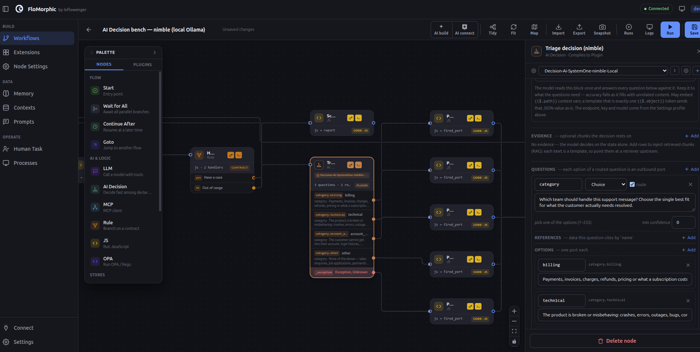
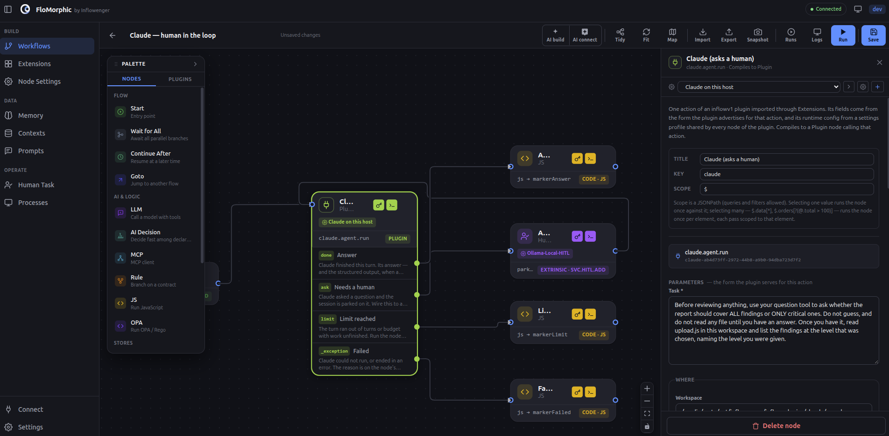
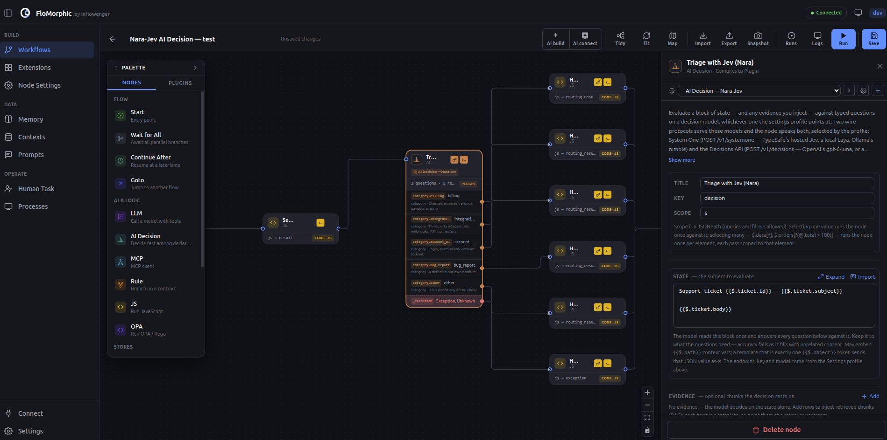

<div align="center">

# FloMorphic

**Contract-driven AI: the process governs the model, not the other way round.**

The open-source AI harness for building your own agents and AI-native systems,
low-code, on the [Inflowenger](https://inflowenger.com) context runtime you own.

[**Website**](https://inflowenger.com/flomorphic) ·
[**Get started**](https://github.com/FloMorphic/getting-started) ·
[**Docs**](https://inflowenger.com/docs) ·
[**Wiki**](https://github.com/Inflowenger/wiki) ·
[**Blog**](https://inflowenger.com/blog) ·
[**Cookbook**](https://github.com/FloMorphic/flow-cookbook)



<sub>One canvas: capabilities are nodes, edges are the decisions the model is allowed to make.</sub>

</div>

---

## What is FloMorphic?

FloMorphic is a visual canvas for engineering the *flow* of an AI system. Instead of
hand-assembling a prompt loop, a vector store, a tool router and an approval step into
code you then have to redeploy, you draw them as nodes on one graph, over one shared,
durable context:

`RAG` · `context engineering` · `agent loops` · `tool use` · `MCP` · `long-term memory` ·
`guardrails & policy` · `human-in-the-loop` · `multi-agent orchestration` · `observability`

Every one of those is an ordinary node. The model is a *bounded participant*: the
decisions it may make are edges you can see, and a loop is just an edge pointing
backward with a condition. The whole process iterates over a context object that
survives a wait, an approval, or a crash.

## The inversion

Most agent frameworks let the model drive and hope it stays inside the lines. FloMorphic
inverts that: **the model proposes, the graph decides.** The process declares its valid
states, allowed transitions and policies up front. Every node declares what it accepts,
edges route only matching transitions, and the runtime (not an intention in a prompt)
enforces the contract. Every decision stays visible and auditable.

Under the canvas sit just six runtime primitives: **Void** (structure), **Code**
(computation), **Contract** (decision), **Extrinsic** (service calls), **Plugin**
(external processes) and **GoTo** (composition). Everything else, including the LLM and
MCP nodes, is built from them or plugged in.

## Why it's different

- **Flow engineering, not prompt tricks.** Control lives on a layer you can see, edit and
  version — not buried in a prompt or a framework callback.
- **It attaches to the system you already run.** Your backend isn't rewritten or migrated.
  It joins the graph: it answers the graph, and the graph calls it.
- **Change behavior without a redeploy.** Business logic is a workflow graph over living
  context, editable by an operator — the *Software V3* thesis FloMorphic applies to the AI layer.
- **Open all the way down.** The runtime primitives, compiler, API, canvas and the LLM / MCP
  nodes are readable, forkable and self-hostable. The AI nodes are ordinary plugins — which is
  exactly why yours can be too.
- **Drive it from your agent.** The API is itself an MCP server: Claude Code, Claude Desktop
  or Cursor can design a workflow, save it, run it, and read back the result.

> **Not a product. An opportunity.** FloMorphic isn't sold as the finished answer to your
> problem — it's the means to build your own.

## On the canvas

| Human-in-the-loop | Typed triage routing |
| --- | --- |
| [](images/canvas-human-in-the-loop.png) | [](images/canvas-triage-routing.png) |
| A model turn that pauses on `ask` and resumes when a person answers. | One decision node fanning a ticket out to typed outbound ports. |

## Try it in one command

```bash
curl -fsSL https://raw.githubusercontent.com/FloMorphic/getting-started/main/install.sh | bash
```

Docker is the only prerequisite. The canvas comes up on `http://localhost:8088`.

## How it fits together

```
 Canvas (flomorphic-wapp)  ──►  API + compiler (flomorphic-api)  ──►  Inflowenger runtime
 13 intent-level nodes           lowers each node to one of            Infra + Fractal execute
 you drag and wire               six runtime primitives                the graph over context
                                          ▲
                       Plugin nodes (builtin-plugins) · your own backend via inflow-fusion
```

## Repositories

| Repository | What it is |
| --- | --- |
| [**getting-started**](https://github.com/FloMorphic/getting-started) | One-command install, developer guide, and the docs: concepts, nodes, AI harness, architecture, MCP. **Start here.** |
| [**flow-cookbook**](https://github.com/FloMorphic/flow-cookbook) | Worked flows you can import and run — eval loops, RAG, re-embedding a knowledge base, fleet audits. |
| [**morph-wapp**](https://github.com/FloMorphic/morph-wapp) | The canvas: Vue 3 + Vue Flow + TypeScript. |
| [**morph-api**](https://github.com/FloMorphic/morph-api) | The backend: Go + Fiber, SQLite + sqlite-vec, the graph compiler, and the `/mcp` endpoint. |
| [**builtin-plugins**](https://github.com/FloMorphic/builtin-plugins) | The stock plugin nodes — `llm`, `mcp`, `http`, `cast`, `ai-decision` — ordinary Go binaries you can copy. |

## Learn more

- **[inflowenger.com/flomorphic](https://inflowenger.com/flomorphic)** — the product overview. Also: [installation](https://inflowenger.com/installation) · [ecosystem](https://inflowenger.com/ecosystem).
- **Blog** — [a walkthrough of FloMorphic](https://inflowenger.com/blog/flomorphic-claims-walkthrough) ·
  [driving FloMorphic from your agent](https://inflowenger.com/blog/drive-flomorphic-from-your-agent) ·
  [your evaluator is a node](https://inflowenger.com/blog/your-evaluator-is-a-node) ·
  [cardinality is the loop you didn't write](https://inflowenger.com/blog/cardinality-is-the-loop-you-didnt-write) ·
  [extend like an extension](https://inflowenger.com/blog/extend-like-an-extension)
- **The Inflowenger Book (wiki)** — [github.com/Inflowenger/wiki](https://github.com/Inflowenger/wiki):
  [what FloMorphic is](https://github.com/Inflowenger/wiki/blob/main/book/05-flomorphic/what-it-is.md) ·
  [the node palette](https://github.com/Inflowenger/wiki/blob/main/book/05-flomorphic/the-palette.md) ·
  [the AI harness](https://github.com/Inflowenger/wiki/blob/main/book/05-flomorphic/ai-harness.md) ·
  [driving it over MCP](https://github.com/Inflowenger/wiki/blob/main/book/05-flomorphic/mcp.md)
- **The thesis** — [Software as a graph over living context](https://github.com/Inflowenger/wiki/blob/main/book/00-preface/the-thesis.md):
  business logic is a workflow graph an operator can change without a redeploy.
- **Underneath** — [Inflowenger](https://github.com/Inflowenger) is the context runtime FloMorphic is built on;
  [`inflow-fusion`](https://github.com/Inflowenger/inflow-fusion) is the Go SDK that binds your backend into it.
- **Venapce** — a sibling project on the same runtime: [inflowenger.com/venapce](https://inflowenger.com/venapce).

## Contribute

Node kinds, plugin nodes, storage drivers, recipes, docs and installer coverage are all
welcome. The APIs are pre-1.0 and moving — please open an issue before a large change.

Everything here is [Apache-2.0](https://www.apache.org/licenses/LICENSE-2.0). "Inflowenger" and
"FloMorphic" are trademarks.

<div align="center">
<sub>Part of the Inflowenger platform · Where context becomes computation.</sub>
</div>
